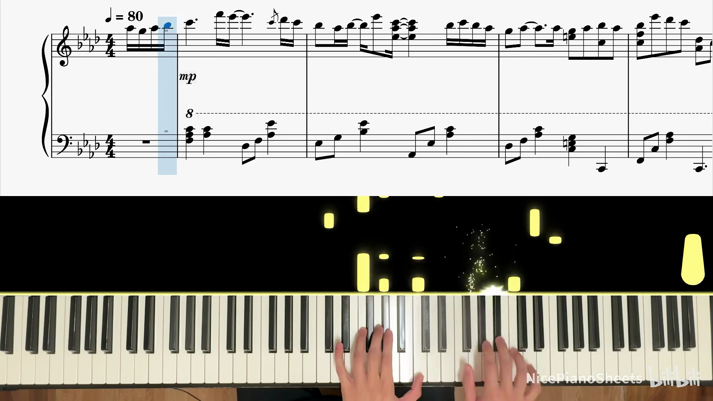
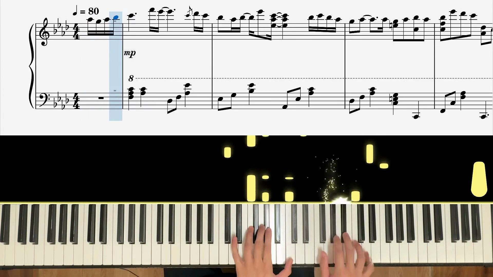

# TextRemover

Remove fixed-position text overlays from videos with LaMa inpainting. The tool
processes an input directory, detects text within a selected region,
and writes MP4 videos while preserving the source frame rate and audio (when
present). It supports CPU, NVIDIA CUDA, and Ascend NPU inference, parallel video
processing, and resumable runs.

## Example

| Original frame | Text removed |
| --- | --- |
|  |  |

## Installation

Use Python 3.10 for this repository's dependency set. A desktop display and
OpenCV GUI support are needed for interactive region selection, previews, and
the pixel locator. For processing on a server without a display, pass `--roi`
and leave `--preview` disabled.

Clone the repository:

```bash
git clone https://github.com/lxulxu/WatermarkRemover.git TextRemover
cd TextRemover
```

### Option A: venv

Create an environment with a Python 3.10 interpreter:

```bash
python3.10 -m venv .venv
source .venv/bin/activate
```

On Windows, use `py -3.10 -m venv .venv`, then activate it with one of:

```powershell
# PowerShell
.venv\Scripts\Activate.ps1
```

```bat
:: Command Prompt
.venv\Scripts\activate.bat
```

### Option B: Conda

```bash
conda create --name text-remover python=3.10 pip -y
conda activate text-remover
```

### Install PyTorch and project dependencies

Run the following steps inside either activated environment:

```bash
python -m pip install --upgrade pip
```

Install the PyTorch build for your hardware before the project requirements:

- **CPU (Linux/Windows):**

  ```bash
  python -m pip install torch torchvision --index-url https://download.pytorch.org/whl/cpu
  ```

  On macOS, use `python -m pip install torch torchvision` and select `--device cpu`
  when running this tool.

- **NVIDIA CUDA:** use the command from the [PyTorch installer](https://pytorch.org/get-started/locally/)
  for your operating system and supported CUDA build. For a release supporting
  Python 3.10, consult [previous PyTorch versions](https://pytorch.org/get-started/previous-versions/).
  Verify the installation with:

  ```bash
  python -c "import torch; print(torch.cuda.is_available())"
  ```

- **Ascend NPU:** install compatible PyTorch and `torch_npu` builds for your CANN
  and driver versions, following the [Ascend installation guide](https://github.com/Ascend/pytorch#installation)
  and [compatibility table](https://github.com/Ascend/pytorch/blob/master/COMPATIBILITY.en.md).
  Load your installation's CANN and driver environment scripts before running
  Python, and ensure the selected devices are exposed to the process.

Then install the pinned project dependencies:

```bash
python -m pip install -r requirements.txt
python text_remover.py --help
```

The first inference downloads the LaMa model unless it is already cached. Allow
network access for that initial download.

## Text removal

Run commands from the repository root. `--input` is a directory; files directly
inside it are checked for valid video content. Subdirectories are not scanned.

### Interactive selection

```bash
python text_remover.py --input /path/to/videos --output /path/to/output --device cpu
```

The program shows a frame from the first pending video. Drag a rectangle around
the text, then press **Space** or **Enter**. That region is shared by the
batch, and a text mask is generated separately for each video.

To preview each video's result before encoding:

```bash
python text_remover.py -i /path/to/videos -o /path/to/output --device cpu --preview
```

Press **Enter** in the preview to process that video, or **Esc** to skip it.
Preview mode processes videos serially.

### Numeric ROI and headless processing

Coordinates are zero-based pixels in the source video, with `(0, 0)` at the
top-left. `X` increases to the right and `Y` increases downward. Supply the
rectangle as `X Y WIDTH HEIGHT`, not two opposite corners:

```bash
python text_remover.py -i /path/to/videos -o /path/to/output --device cpu --roi 120 40 300 80
```

This rectangle covers columns 120–419 and rows 40–119. Use the pixel locator
below to find suitable coordinates. A rectangle outside a video's bounds is
recorded as a failure for that video, and the remaining videos continue.

### Accelerator examples

Use NVIDIA CUDA and fail if CUDA is unavailable:

```bash
python text_remover.py -i /path/to/videos -o /path/to/output --device cuda --require-device --roi 120 40 300 80
```

Use specific Ascend NPUs (one video per assigned device):

```bash
python text_remover.py -i /path/to/videos -o /path/to/output --device npu --device-id 0 1 --require-device --roi 120 40 300 80
```

Test LaMa inference on the first selected NPU and exit:

```bash
python text_remover.py --npu-preflight --device-id 0
```

The default device is **NPU**, with requested IDs **0–7**. On systems exposing
fewer NPUs, explicitly pass the available IDs, for example `--device-id 0`.
If the requested accelerator is unavailable, processing falls back to CPU unless
`--require-device` is set. NPU activation or inference errors also trigger a CPU
retry unless that flag is set. CUDA inference errors are recorded as failures.

### Command-line options

| Option | Meaning | Default |
| --- | --- | --- |
| `--input`, `-i` | Directory containing input videos | `.` |
| `--output`, `-o` | Output directory | `output` |
| `--preview`, `-p` | Preview each result before processing | Disabled |
| `--roi X Y WIDTH HEIGHT` | Text region in source pixels | Interactive selection |
| `--retry-failed` | Retry matching failed entries in the state file | Disabled |
| `--device {npu,cuda,cpu}` | Inference backend | `npu` |
| `--device-id ID [ID ...]` | Requested NPU device IDs | `0 1 2 3 4 5 6 7` |
| `--workers WORKERS` | Concurrent CPU/fallback video workers; must be at least 1 | `8` |
| `--require-device` | Fail instead of falling back to CPU | Disabled |
| `--npu-preflight` | Run a small LaMa inference on the first selected NPU and exit | Disabled |

CPU processing uses up to `--workers` concurrent videos. NPU processing uses up
to the number of selected devices; CUDA processing uses one video worker.

### Outputs and resuming

Outputs use the input filename stem: `example.mov` becomes `example.mp4`.
Encoding uses H.264 video and AAC audio. A temporary `example.part.mp4` is
validated before it replaces the final output.

After each success or failure, the output directory's
`.text_remover_state.json` is updated atomically. The previous manifest is
loaded if the new one is absent. Rerunning the same command:

- Skips matching successful entries whose output is still readable.
- Skips matching failed entries unless `--retry-failed` is passed.
- Processes an input again if its size/modification time or explicitly supplied
  ROI has changed.
- Recognizes readable, same-stem MP4 outputs from older runs without state entries.

Use separate output directories when comparing different settings. Input files
in a batch must have unique filename stems to avoid output collisions.

### Calling the main function from Python

The script entry point also exports `main(argv=None)`. Pass a list of
CLI arguments, or omit it to read arguments from the command line. Keep the call
under a main guard because batch processing starts child processes:

```python
from text_remover import main

if __name__ == "__main__":
    main([
        "--input", "/path/to/videos",
        "--output", "/path/to/output",
        "--device", "cpu",
        "--workers", "2",
        "--roi", "120", "40", "300", "80",
    ])
```

`TextDetector`, `TextProcessor`, `initialize_lama`, and `process_video` are
importable from `text_remover`.

## Pixel and ROI locator

`locate_pixel.py` opens an image or a video frame without loading LaMa. It uses
the existing OpenCV/NumPy dependencies:

```bash
# Inspect an image
python locate_pixel.py image/origin.jpg

# Inspect the video frame at 12.5 seconds
python locate_pixel.py /path/to/video.mp4 --time 12.5
```

- Move the pointer to see source `(x, y)` coordinates and RGB values.
- Left-click to print the pixel coordinates and RGB values in the terminal.
- Drag with the left mouse button to print a ready-to-use `--roi X Y WIDTH HEIGHT`.
  Both drag endpoints are included in the rectangle.
- Right-click to clear the rectangle. Press **Enter**, **Esc**, or **Q** to exit.

The preview fits within 1280×720 image pixels by default. Coordinates always
refer to the original resolution, even when the preview is scaled. For precise
selection in a large image, increase `--max-width` and `--max-height` to display
it closer to its original size.

On a server without a display, export an unscaled frame and inspect it on a
machine with a desktop:

```bash
python locate_pixel.py /path/to/video.mp4 --time 12.5 --export frame.png
# On the desktop machine, with OpenCV and NumPy installed:
python locate_pixel.py frame.png
```

`--export` saves the frame and exits without creating a window. The destination's
parent directory must already exist. Run `python locate_pixel.py --help` for
all options.

## Repository structure

```text
text_remover.py       # CLI entry point and public helper imports
locate_pixel.py            # Pixel/ROI locator entry point
text_tools/
    cli.py                # Arguments and batch orchestration; main()
    detection.py          # ROI selection and text mask generation
    devices.py            # CUDA and NPU availability checks
    inpainting.py         # LaMa initialization and RGB normalization
    processing.py         # Frame blending, encoding, and device workers
    state.py              # Resumable state and pending video discovery
    video.py              # Video metadata and file validation
    pixel_locator.py      # Image/video pixel inspection
tests/                    # Coordinate and processing regression checks
requirements.txt          # Pinned project dependencies
image/                    # Before/after examples
```

## Limitations

- Designed for static text overlays.
- The shared ROI must cover the text and fit within every video in the batch.
  Group videos by text position and layout for consistent results.
- Detection thresholds a sampled set of frames within the ROI; enclosing unrelated
  bright details can include them in the removal mask.
- Interactive tools require a desktop display and GUI-enabled OpenCV.

## Tests

Run the regression suite inside the configured environment:

```bash
python -m unittest discover -s tests -v
```

The suite checks pixel coordinates, video frame loading/export, text mask
and RGB behavior, resumable state, and MP4 encoding. It uses small generated
videos and a substitute inpainting model, so no model download is needed.

## License

[GNU General Public License v3.0](LICENSE).
